# Proyecto conjunto EDD y SIR Primer Trimestre

## Misión: preparar un entorno de desarrollo reproducible

### 1. Planificar e instalar la máquina virtual

Para instalar una máquina virtual con **Ubuntu** sobre un equipo con **Windows 11 Pro**, procesador **Intel Core i5-11400** (6 núcleos físicos y 12 hilos) y **16 GB de RAM** (15,8 GB utilizables), una propuesta equilibrada consiste en asignar **4 GB de RAM**, **4 núcleos de procesador** y un **disco virtual VDI de 50 GB con reserva dinámica**.

- **Memoria RAM (4 GB):** Da suficiente holgura para que Ubuntu, su entorno gráfico y las aplicaciones de trabajo o desarrollo funcionen sin tirones, mientras deja unos **11,8 GB utilizables** para Windows 11 Pro y evita que el sistema anfitrión se sature o recurra en exceso a la memoria virtual.
- **Procesamiento (4 núcleos):** Aprovecha la mayor parte de los **6 núcleos físicos** disponibles para acelerar compilaciones, actualizaciones y tareas dentro de Ubuntu, pero conserva **2 núcleos físicos libres** para que Windows 11 Pro siga respondiendo con normalidad en segundo plano.
- **Almacenamiento (50 GB en formato VDI dinámico):** Ofrece espacio de sobra para paquetes, herramientas y archivos de proyecto sin obligar a reservar los 50 GB desde el principio, ya que el archivo crece de forma progresiva según el espacio que vaya ocupando la máquina virtual.

**Creación de la máquina virtual e instalación de Linux:** Se creó la máquina virtual `Pratica-Tiozeio` en Oracle VirtualBox aplicando los recursos planificados a partir de la imagen ISO indicada, completando el asistente inicial y verificando el arranque del sistema operativo.

**Actualización del sistema e instalación de herramientas:** 

Una vez completada la instalación de Ubuntu 26.10 en la máquina virtual (`Pratica-Tiozeio`), el primer paso consistió en sincronizar los repositorios oficiales y actualizar los paquetes base del sistema operativo para garantizar la estabilidad y aplicar los últimos parches de seguridad. Para ello, se ejecutaron desde la terminal los comandos `sudo apt update` y `sudo apt upgrade -y`.

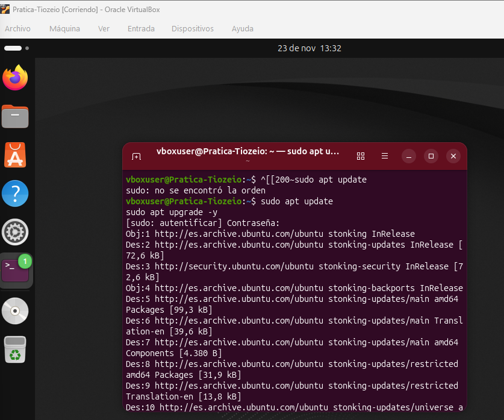

Con el sistema actualizado, se procedió a instalar y verificar las herramientas necesarias para el desarrollo, control de versiones y depuración del proyecto Java:

Kit de Desarrollo de Java (`default-jdk`)
  
Se instaló el paquete estándar de OpenJDK mediante `sudo apt install default-jdk -y`, lo que incorpora el compilador (`javac`) y el entorno de ejecución (`java`) correspondientes a **OpenJDK 25.0.5.1**. Su correcta instalación se verificó ejecutando `java -version`.

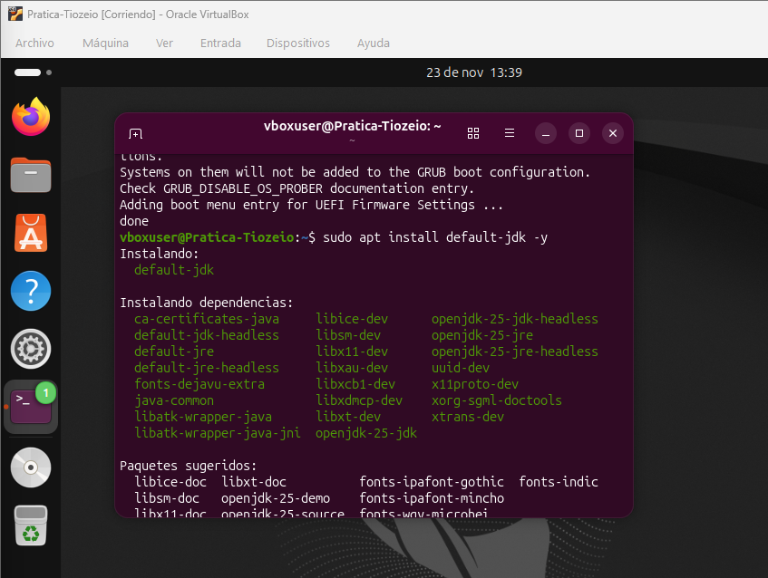
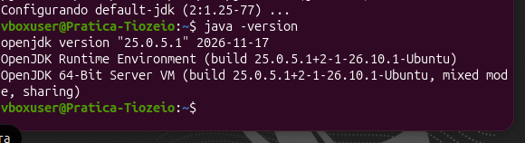

Control de versiones (`git`)

Para gestionar el repositorio remoto, el historial de cambios y el trabajo con ramas, se instaló Git mediante `sudo apt install git -y` (versión **2.55.0**), comprobando su disponibilidad en el sistema con `git --version`.

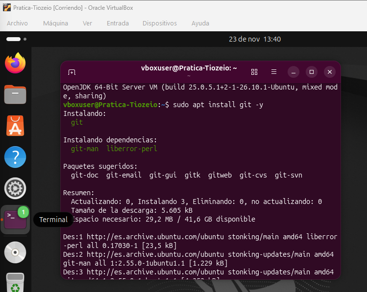
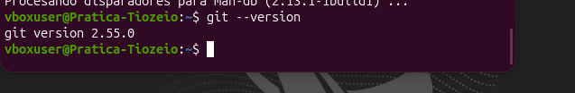

Entorno de desarrollo integrado (Visual Studio Code)

Tras descargar el instalador desde la web oficial de Visual Studio Code, se optó por su instalación mediante paquete Snap con el comando `sudo snap install code --classic` para facilitar su integración en el escritorio y sus actualizaciones automáticas. Se validó el funcionamiento ejecutando `code --version` (versión **1.147.0**).

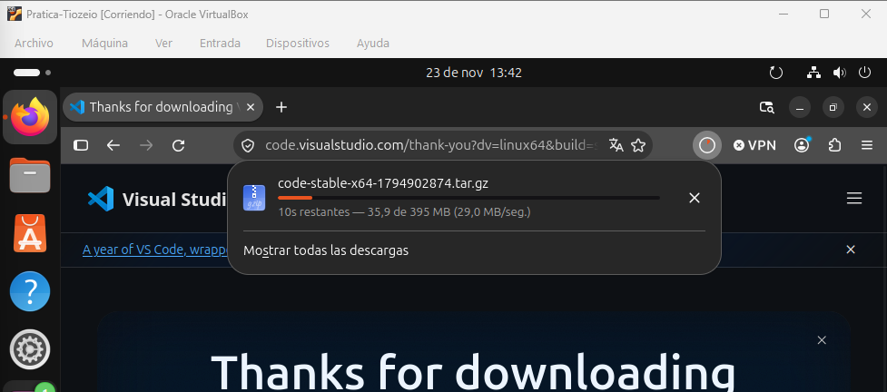
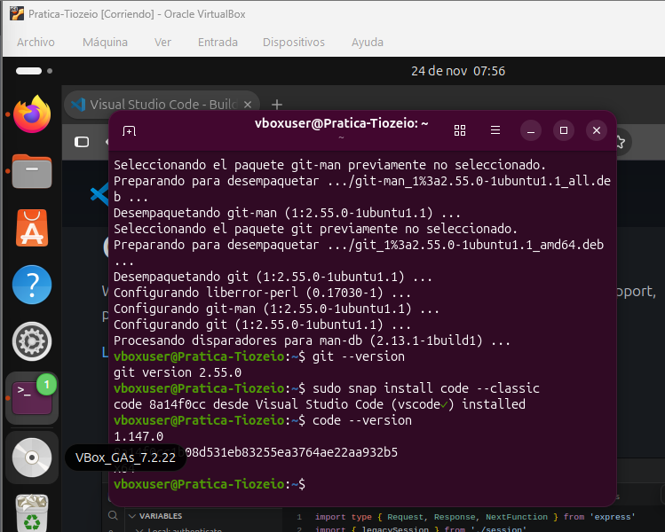
    

**Integración con el equipo anfitrión:**

Para trabajar con comodidad entre el sistema anfitrión (Windows 11 Pro) y la máquina virtual (Ubuntu 26.10), se montó la imagen de disco de las *Guest Additions* de VirtualBox (`VBox_GAs_7.2.22`), lo que habilita la aceleración gráfica, el ajuste automático de resolución de pantalla y la comunicación directa entre ambos sistemas. 

  Una vez instaladas las *Guest Additions*, se accedió al menú superior de VirtualBox (**Dispositivos → Portapapeles compartido**) y se seleccionó la opción **Bidireccional**, permitiendo copiar y pegar texto y comandos directamente entre Windows y Ubuntu. De forma complementaria, se habilitó una **carpeta compartida** (`carpeta_compartida`) montada en el sistema invitado para transferir archivos del proyecto sin necesidad de red externa.

  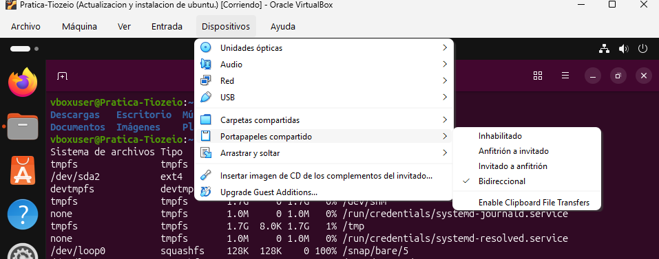

**Punto de recuperación y comprobación de restauración:**

 Antes de comenzar a manipular archivos del sistema, configurar almacenamiento adicional o modificar el proyecto Java, se creó una **instantánea (snapshot)** desde el Administrador de Oracle VirtualBox sobre la máquina virtual apagada (`Pratica-Tiozeio`). Esta instantánea, denominada **"Actualizacion e instalacion de ubuntu."**, guarda el estado limpio del sistema con Ubuntu 26.10 actualizado y las herramientas base instaladas (OpenJDK, Git y Visual Studio Code), permitiendo revertir cualquier fallo futuro en cuestión de segundos.

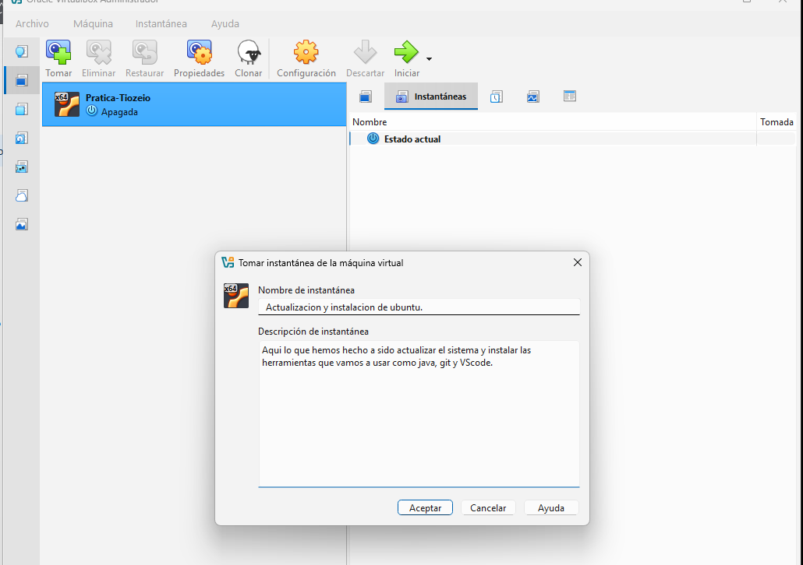

Para verificar que el mecanismo de recuperación funciona correctamente ante una modificación no deseada, se realizó la siguiente prueba de restauración:
  1. Se inició la máquina virtual y se simuló un cambio en el sistema (creando un archivo/modificación de prueba en el directorio de trabajo).
  2. Se apagó la máquina virtual y, desde la pestaña **Instantáneas** de VirtualBox, se seleccionó el punto **"Actualizacion y instalacion de ubuntu."** pulsando sobre **Restaurar**.
  3. Al arrancar de nuevo la máquina virtual, se comprobó que el sistema había vuelto exactamente al estado limpio guardado, desapareciendo los cambios realizados con posterioridad a la instantánea.

### 2. Gestionar el sistema y proteger la información:

#### Directorios e información

En Ubuntu podemos explorar las carpetas desde el **gestor de archivos** o usar la terminal. La carpeta personal (`/home/usuario`) guarda documentos y proyectos; `/etc` contiene configuraciones y `/var` almacena datos variables, como registros.

#### Sistemas de archivos y almacenamiento

Los sistemas de archivos organizan cómo se guardan los datos. **ext4** es habitual en Linux, **NTFS** en Windows y **FAT32** es compatible con muchos dispositivos, aunque limita el tamaño de cada archivo. Con `df -h` consultamos las unidades, el espacio usado y el espacio disponible. En la práctica, esta información ayuda a reconocer las particiones y unidades lógicas de la máquina virtual.

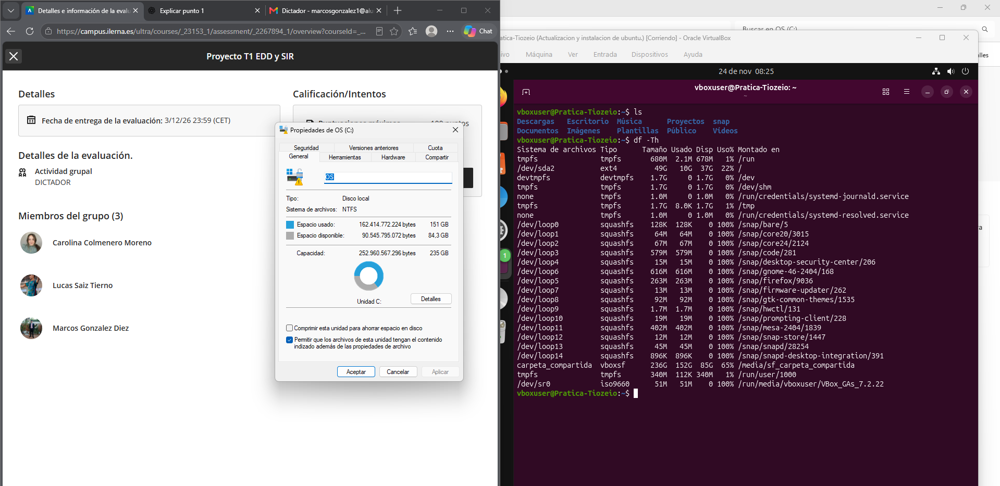

#### Copia de seguridad
- **Copia de seguridad de datos de trabajo y comprobación de restauración:** Para proteger los datos y el entorno de trabajo se realizó una **clonación completa** de la máquina virtual `Pratica-Tiozeio` desde Oracle VirtualBox bajo el nombre **"Copia de seguridad"** (tomando el estado actual), generando una réplica íntegra y operativa del sistema listo para restaurarse ante cualquier fallo grave.

  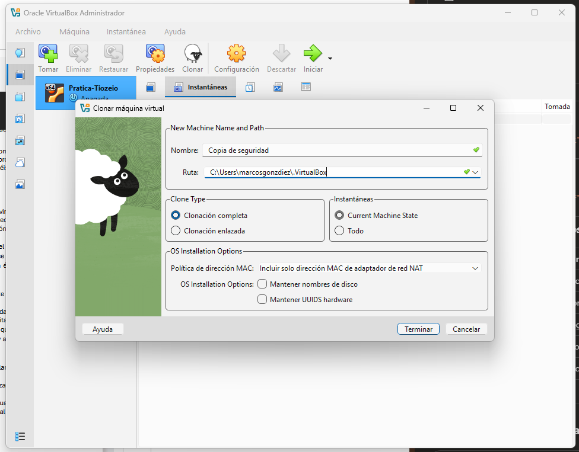

  > **INCIDENCIA 01 — Alcance insuficiente en la copia de seguridad inicial**
  > - **Problema detectado:** En una primera prueba se realizó una copia manual mediante `cp -r ~/Documentos/Proyecto ~/CopiasSeguridad/` sobre un directorio concreto y se comprobó su restauración borrando y recuperando `prueba.txt` con `tree`. Sin embargo, este método solo protegía una carpeta puntual sin compresión, sin marcas de tiempo y dejando desprotegidas las configuraciones del sistema, las herramientas instaladas y el entorno de desarrollo completo.
  > - **Resolución aplicada:** Se amplió la estrategia de protección en dos niveles: por un lado, realizando una **clonación completa de la máquina virtual** en VirtualBox para salvaguardar todo el entorno listo para arrancar; y por otro, automatizando copias comprimidas en formato `.tar.gz` mediante `tar` y `cron` para los archivos de trabajo diarios.

  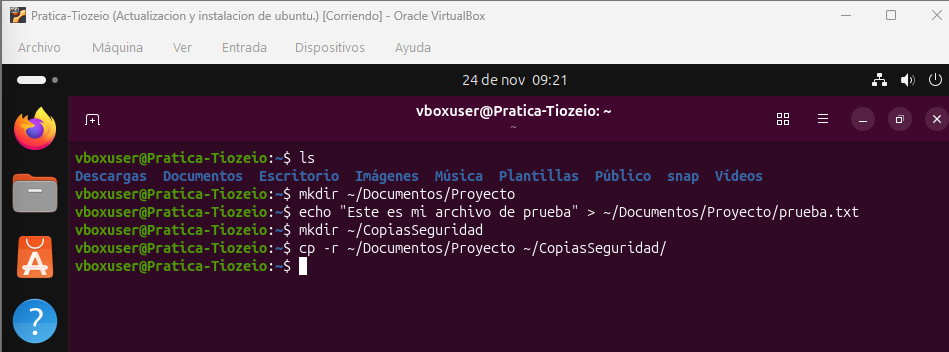
  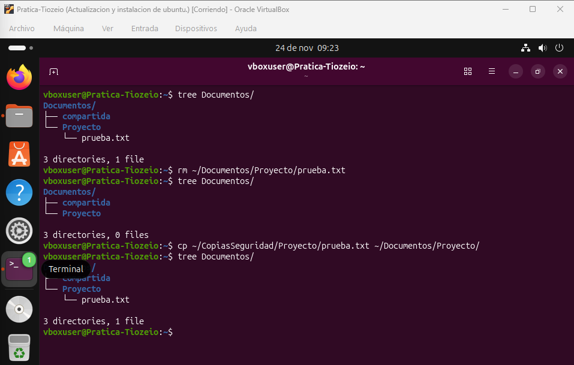

- **Evaluación de utilidad y automatización de tareas:** Para la gestión y respaldo de información en Linux se evaluó **`tar`** (junto con compresión gzip, `-czf`), una utilidad estándar de línea de comandos muy práctica para empaquetar y comprimir directorios completos en un único archivo (`.tar.gz`) de forma rápida y reproducible, ideal para copias locales o scripts.

Se creó y depuró el script `backup.sh` con `nano` para automatizar el respaldo de `Documentos` hacia `/home/$USER/backup_home.tar.gz` y se programó su ejecución periódica mediante **`cron`** (`crontab -e`), seleccionando `nano` como editor predeterminado y comprobando la instalación del `crontab.

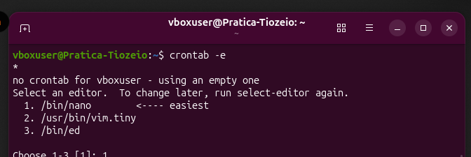
  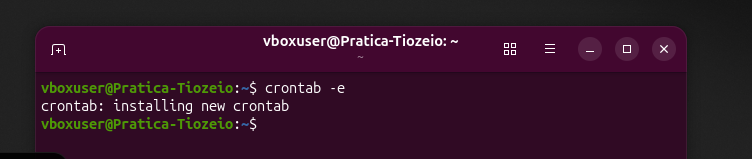

> **INCIDENCIA 02 — Error de sintaxis en el script de automatización (`backup.sh`)**
  > - **Problema detectado:** Al redactar inicialmente el script `backup.sh`, se introdujeron por error caracteres comodín (`*`) en lugar del guion de opciones y de los espacios en la ruta de destino (`tar *czf /*ome/$USER/backup_home.tar.gz*/home/$USER/Documentos`), lo que provocaba un fallo de sintaxis al ejecutar `tar` e impedía generar el archivo comprimido.
  > - **Resolución aplicada:** Se revisó el archivo con `nano`, se corrigieron las opciones a `-czf` y las rutas absolutas (`/home/$USER/backup_home.tar.gz` y `/home/$USER/Documentos`), y se añadió una línea de confirmación (`echo "Copia de seguridad realizada"`) para verificar su correcta ejecución.

  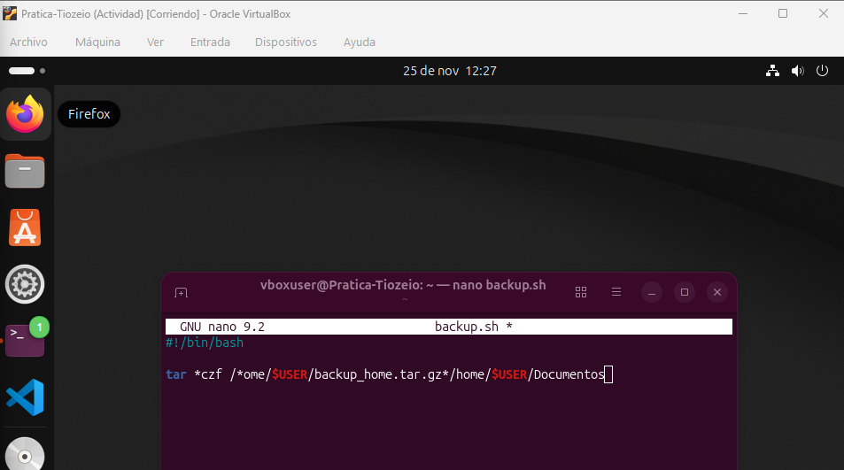
  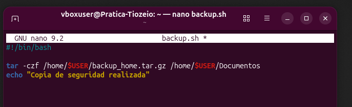

### 3. Preparar el entorno Java

**Instalación del JDK y Visual Studio Code**

Instalamos el JDK con `sudo apt install default-jdk -y`. Incluye las herramientas necesarias para compilar y ejecutar programas Java. Después descargamos Visual Studio Code, que usaremos para editar y trabajar con el proyecto.

**Extensiones y opciones del entorno**

Instalamos **Extension Pack for Java** desde el apartado de extensiones de VS Code. Incluye herramientas para editar código Java, ejecutarlo, depurarlo y trabajar con proyectos. En sus opciones podemos activar o desactivar las actualizaciones automáticas y añadir o quitar extensiones según nuestras necesidades.

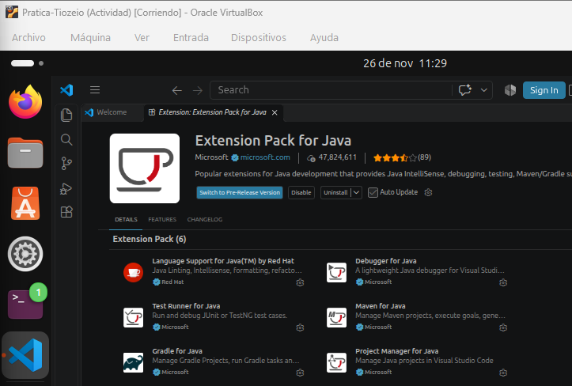

***Preparación de una tarea habitual**

Creamos un archivo Java desde VS Code para disponer de un programa inicial. También dejamos preparada la ejecución desde el entorno, para poder compilar y ejecutar el programa sin tener que escribir los comandos manualmente cada vez.

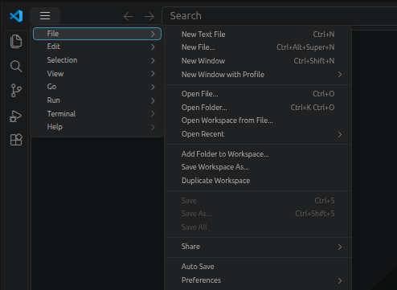

**Prueba de compilación y ejecución**

Antes de modificar el proyecto, comprobamos que el programa inicial se compila y se ejecuta correctamente desde VS Code. La salida `Hola Mundo` en el terminal confirma que el entorno Java y la tarea de ejecución funcionan.

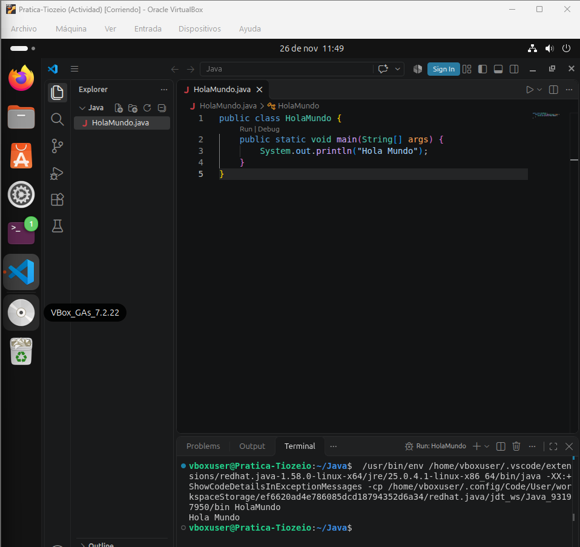