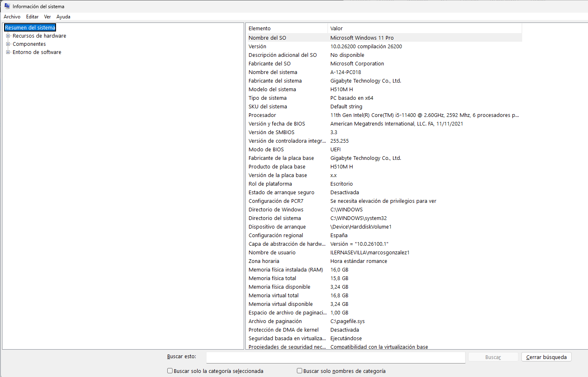
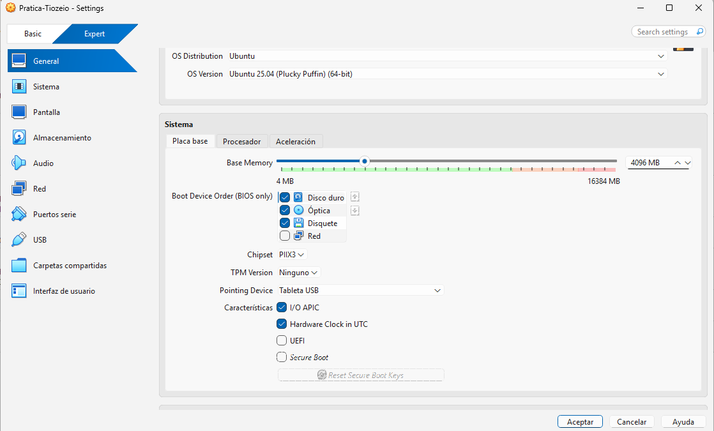
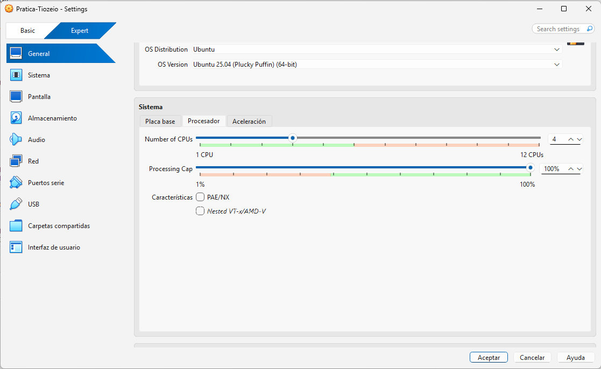
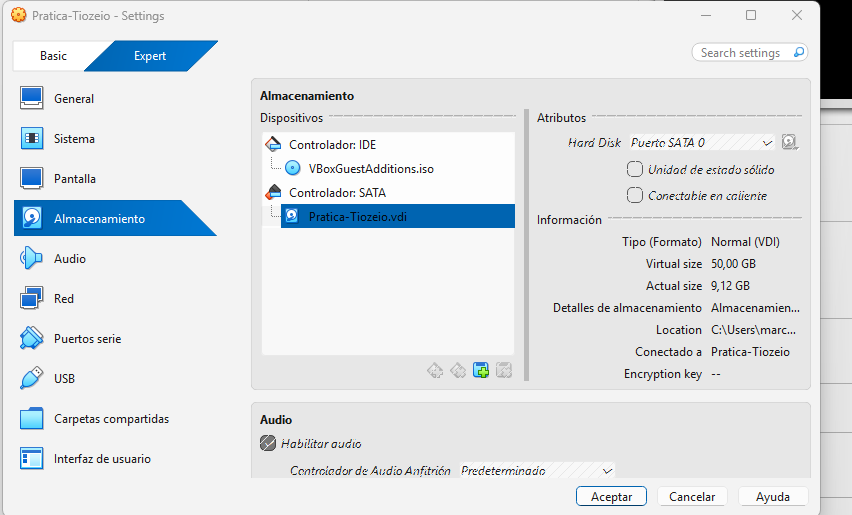

# Proyecto conjunto EDD y SIR Primer Trimestre

## Misión: preparar un entorno de desarrollo reproducible

### 1. Planificar e instalar la máquina virtual

Antes de crear la máquina virtual, revisamos el equipo anfitrión para repartir sus recursos.

**Recursos de nuestro equipo anfitrión (*Host*):**

- **Sistema operativo:** Microsoft Windows 11 Pro.
- **Procesador:** 11th Gen Intel® Core™ i5-11400 @ 2.60 GHz (6 núcleos físicos y 12 hilos).
- **Memoria RAM:** 16,0 GB instalados (15,8 GB utilizables).
- **Placa base:** Gigabyte Technology Co., Ltd. H510M H.

**Justificación técnica de los recursos asignados:**

- **Memoria RAM (4 GB):** Le asignamos 4 GB para que Ubuntu funcione con fluidez y quede memoria disponible para Windows.

  

- **Procesamiento (4 núcleos CPU):** Asignamos 4 núcleos a la máquina virtual y dejamos 2 para Windows.

  

- **Almacenamiento (VDI dinámico de 50 GB):** Elegimos **VDI** con reserva dinámica. El archivo crece según el espacio que ocupa Ubuntu, hasta un máximo de 50 GB.

  

---