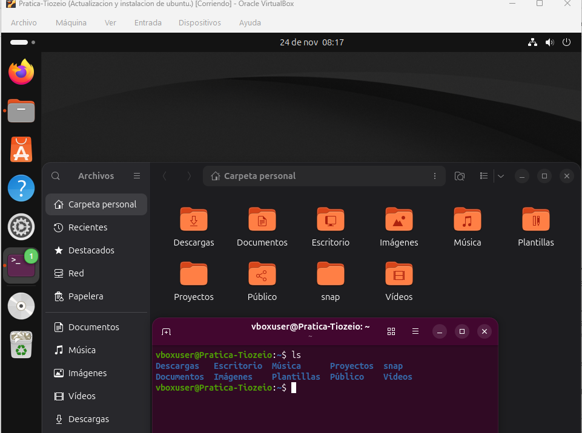

# Proyecto conjunto EDD y SIR Primer Trimestre

## Misión: preparar un entorno de desarrollo reproducible

### 1. Planificar e instalar la máquina virtual

Para instalar una máquina virtual con **Ubuntu** sobre un equipo con **Windows 11 Pro**, procesador **Intel Core i5-11400** (6 núcleos físicos y 12 hilos) y **16 GB de RAM** (15,8 GB utilizables), una propuesta equilibrada consiste en asignar **4 GB de RAM**, **4 núcleos de procesador** y un **disco virtual VDI de 50 GB con reserva dinámica**.

- **Memoria RAM (4 GB):** Da suficiente holgura para que Ubuntu, su entorno gráfico y las aplicaciones de trabajo o desarrollo funcionen sin tirones, mientras deja unos **11,8 GB utilizables** para Windows 11 Pro y evita que el sistema anfitrión se sature o recurra en exceso a la memoria virtual.
- **Procesamiento (4 núcleos):** Aprovecha la mayor parte de los **6 núcleos físicos** disponibles para acelerar compilaciones, actualizaciones y tareas dentro de Ubuntu, pero conserva **2 núcleos físicos libres** para que Windows 11 Pro siga respondiendo con normalidad en segundo plano.
- **Almacenamiento (50 GB en formato VDI dinámico):** Ofrece espacio de sobra para paquetes, herramientas y archivos de proyecto sin obligar a reservar los 50 GB desde el principio, ya que el archivo crece de forma progresiva según el espacio que vaya ocupando la máquina virtual.

### 2. Gestionar el sistema y proteger la información

#### Punto 1. Directorios e información

En Ubuntu podemos explorar las carpetas desde el **gestor de archivos** o usar la terminal. La carpeta personal (`/home/usuario`) guarda documentos y proyectos; `/etc` contiene configuraciones y `/var` almacena datos variables, como registros.



#### Punto 2. Sistemas de archivos y almacenamiento

Los sistemas de archivos organizan cómo se guardan los datos. **ext4** es habitual en Linux, **NTFS** en Windows y **FAT32** es compatible con muchos dispositivos, aunque limita el tamaño de cada archivo. Con `df -h` consultamos las unidades, el espacio usado y el espacio disponible. En la práctica, esta información ayuda a reconocer las particiones y unidades lógicas de la máquina virtual.


#### Punto 3. Copia de seguridad

Una copia de seguridad guarda otra copia de los archivos importantes. Copiamos los datos del proyecto a una ubicación distinta para poder recuperarlos si se pierden o se dañan los originales.


#### Punto 4. Restauración y automatización

Comprobamos la copia restaurando los archivos y revisando que el proyecto se pueda utilizar. Una utilidad sencilla para gestionar copias es `rsync`, que sincroniza carpetas. Podemos automatizar la copia con un script como este:

```bash
#!/bin/bash
rsync -av "$HOME/Proyecto/" "$HOME/Copias/Proyecto/"
```

Al guardarlo como `copia.sh`, darle permiso de ejecución con `chmod +x copia.sh` y programarlo con `crontab -e`, la copia puede ejecutarse automáticamente. Por ejemplo, `0 18 * * * /home/usuario/copia.sh` la ejecuta cada día a las 18:00.


